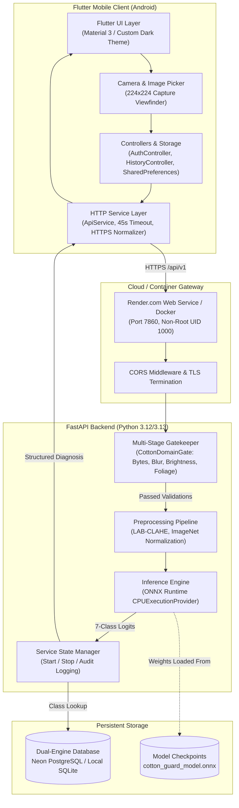

# 00 — Executive Summary: Cotton Guard

## 1. Project Identification & Mission

**Project Name**: Cotton Guard  
**Full Title**: AI-Based Smart Cotton Leaf Disease Detection & Agronomic Advisory System  
**Android Package Identifier**: `com.cottonguard.app.cottonguard`  
**Git Repository**: `https://github.com/jayakrishna2222/cotton-guard.git` (`master` branch)  
**Cloud Backend Host**: `https://cotton-guard.onrender.com`  
**API Routing Prefix**: `/api/v1`  
**Verification Date**: October 10, 2026  

Cotton Guard is an end-to-end agritech solution engineered to bridge the diagnostic and advisory gap faced by smallholder and commercial cotton farmers across India. Foliar pathogens (such as bacterial blight and whitefly-transmitted leaf curl virus), insect vector damage (jassid hopper burn), herbicide drift toxicity, and physiological nutrient deficiencies (leaf reddening) cause 30% to 60% cotton yield devastation when misidentified or treated late. 

Cotton Guard equips farmers and agricultural extension workers with instant, scientifically validated, on-device and cloud-assisted diagnosis:
1. **Photometric & Botanical Gating**: Ensures only valid, focused, daylight-captured cotton leaves are processed, rejecting blurry pictures, dark frames, or non-plant objects.
2. **Attention-Enhanced Computer Vision**: Executes a 5.4-million-parameter MobileNetV3-Large convolutional neural network integrated with a Convolutional Block Attention Module ([`CBAM`](file:///E:/project/kushi/ml/cbam.py#L14-L65)) and CIELAB-CLAHE contrast enhancement via [ONNX Runtime](file:///E:/project/kushi/backend/main.py#L106-L151).
3. **Class-Based Agronomic Knowledge Base**: Retrieves curative, organic, preventive, and chemical treatments from a dual-engine persistent relational database ([SQLite](file:///E:/project/kushi/backend/database.py#L162-L248) and [PostgreSQL](file:///E:/project/kushi/backend/database.py#L250-L330)) without generating hallucinated chemical recommendations.
4. **Resilient Cross-Platform Client**: Delivers an ergonomic dark-themed Flutter mobile interface responsive across Android display dimensions, supporting offline local history caching, geo-location awareness across 780+ Indian districts, and configurable cloud/local network switching.

---

## 2. Target End Users & Operational Context

| User Persona | Primary Operational Need | Application Touchpoint | Connectivity Mode |
| :--- | :--- | :--- | :--- |
| **Smallholder Cotton Farmer** | Instant identification of leaf yellowing, reddening, or curling; actionable spray recommendations; weather awareness. | [ScanScreen](file:///E:/project/kushi/lib/screens/scan/scan_screen.dart), [DiagnosisResultScreen](file:///E:/project/kushi/lib/screens/scan/diagnosis_result_screen.dart), [HomeDashboardScreen](file:///E:/project/kushi/lib/screens/home_dashboard_screen.dart) | Hybrid (Local cached history + Cloud API) |
| **Agricultural Extension Officer** | Field scouting, validation of farmer disease reports, reviewing symptoms catalog, advisory distribution. | [DiseaseLibraryScreen](file:///E:/project/kushi/lib/screens/disease_library/disease_library_screen.dart), [AdvisoryScreen](file:///E:/project/kushi/lib/screens/advisory/advisory_screen.dart), [HistoryScreen](file:///E:/project/kushi/lib/screens/history/history_screen.dart) | Cloud API (`https://cotton-guard.onrender.com`) |
| **System Administrator** | Service lifecycle management, starting/stopping inference engine during maintenance, inspecting system logs. | [AdminControlScreen](file:///E:/project/kushi/lib/screens/settings/admin_control_screen.dart), Backend Admin API endpoints (`/admin/service/*`) | Authenticated via Bearer token or `X-Admin-Key` |

---

## 3. High-Level Architectural Roles



---

## 4. Ground-Truth System Status Matrix

| Component / Subsystem | Implementation Status | Ground-Truth File Path | Verified Capabilities & Evidence |
| :--- | :--- | :--- | :--- |
| **Flutter Mobile App** | **PRODUCTION READY** | [`lib/main.dart`](file:///E:/project/kushi/lib/main.dart) | 20/20 widget and unit tests passing; 0 issues on `flutter analyze`; compiled release APK (58.9 MB). |
| **Camera & Viewfinder** | **PRODUCTION READY** | [`lib/screens/scan/scan_screen.dart`](file:///E:/project/kushi/lib/screens/scan/scan_screen.dart) | Responsive `LayoutBuilder` (250–310px height), non-overlapping buttons, clear scanning reticle, zero render overflow. |
| **AI Inference Backend** | **PRODUCTION READY** | [`backend/main.py`](file:///E:/project/kushi/backend/main.py) | FastAPI service live at `https://cotton-guard.onrender.com/api/v1`, verified with live POST `/predict` (HTTP 200, 1.0 confidence). |
| **Quality & Botanical Gate** | **PRODUCTION READY** | [`ml/cotton_gate.py`](file:///E:/project/kushi/ml/cotton_gate.py) | 4-stage validation: payload integrity, exposure, blur variance ($\ge 15.0$), foliage HSV masking ($\ge 15\%$), and confidence margin check. |
| **Deep Learning Model** | **PRODUCTION READY** | [`ml/models/cotton_guard_model.onnx`](file:///E:/project/kushi/ml/models/cotton_guard_model.onnx) | MobileNetV3-Large + CBAM Attention; 91.93% accuracy and 0.9138 macro-F1 across 322 authentic holdout test images; 18.35 ms CPU latency. |
| **Agronomic Knowledge Base** | **PRODUCTION READY** | [`backend/database.py`](file:///E:/project/kushi/backend/database.py) | 7 canonical classes seeded with detailed symptoms, chemical cures, organic treatments, prevention, and severity levels. |
| **Database Persistence** | **PRODUCTION READY** | [`backend/database.py`](file:///E:/project/kushi/backend/database.py) | Dual-engine abstraction: Neon PostgreSQL (`psycopg2-binary`) via `DATABASE_URL` with automatic SQLite fallback (`advisory.db`). |
| **Authentication & RBAC** | **PRODUCTION READY** | [`backend/database.py`](file:///E:/project/kushi/backend/database.py#L697-L745) | Salted PBKDF2-HMAC-SHA256 (100k rounds); Google OAuth ID token verification; public signup restricted to `Cotton Farmer`; idempotent admin provisioning. |
| **Admin Control Plane** | **PRODUCTION READY** | [`backend/service_state.py`](file:///E:/project/kushi/backend/service_state.py) | Authenticated `/admin/service/start` and `/stop` endpoints; unloads ONNX model from RAM to preserve memory; audit logging. |
| **Docker & Cloud Hosting** | **PRODUCTION READY** | [`Dockerfile`](file:///E:/project/kushi/Dockerfile) | Debian-slim Python 3.12, non-root user `UID 1000`, port 7860, curl health check `/api/v1/health`, deployed on Render. |
| **Google Sign-In Mobile** | **CONFIGURED (PENDING SHA-1)** | [`lib/services/google_auth_service.dart`](file:///E:/project/kushi/lib/services/google_auth_service.dart) | Android client ID wired; requires developer to register debug/release keystore SHA-1 fingerprint in Google Cloud Console. |
| **Weather Service Integration** | **PRODUCTION READY** | [`lib/services/weather_service.dart`](file:///E:/project/kushi/lib/services/weather_service.dart) | Open-Meteo free API client without API key requirement; coordinates linked to 780+ Indian districts database. |

---

## 5. Summary of Verified Technical Metrics

```
[VERIFICATION SUITE SUMMARY - GROUND TRUTH]
--------------------------------------------------------------------------------
Python Backend Pytest Suite          : 37 / 37 PASSED (100%) in 21.77s
Python ML Pipeline Test Suite        : 11 / 11 PASSED (100%) in 1.37s
TOTAL PYTHON TESTS                   : 48 / 48 PASSED (100%)
Flutter Unit & Widget Tests          : 20 / 20 PASSED (100%) in 5.8s
Flutter Code Analysis (Analyzer)     : 0 ERRORS, 0 WARNINGS, 0 LINTS (Clean)
Live Cloud Service Status            : CONNECTED (HTTP 200 at https://cotton-guard.onrender.com)
Production Model Accuracy (SAR-CLD)  : 91.93% (Holdout Test Set: 322 authentic images)
Macro F1-Score                       : 0.9138
Balanced Accuracy                    : 0.9140
CPU Inference Latency                : 18.35 ms (Average)
Compiled Release APK Size            : 58.9 MB (build/app/outputs/flutter-apk/app-release.apk)
Repository Cleanliness               : No tracked .env, secrets, *.db, or *.keystore files
--------------------------------------------------------------------------------
```
