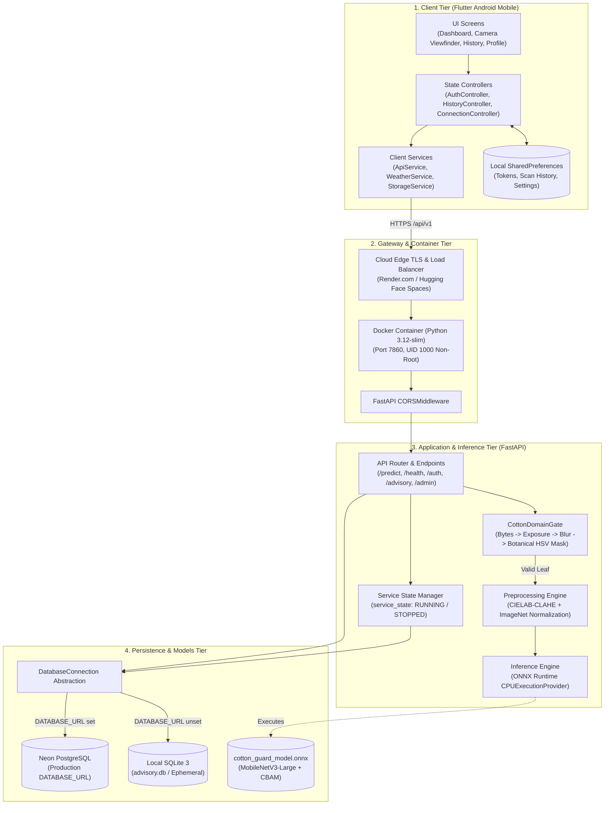

# 03 — System Architecture & Data Flow

This document details the architectural design, component interactions, network boundaries, and data flows of the **Cotton Guard** system.

---

## 1. High-Level Architecture Overview

The Cotton Guard architecture comprises four decoupled, resilient tiers:
1. **Client Tier**: A Flutter mobile application designed for Android devices, providing camera capture, local state persistence, offline history caching, and dynamic server routing.
2. **Gateway & Container Tier**: A containerized Linux environment running on Render.com Web Services (or Hugging Face Spaces) that enforces non-root UID 1000 execution, TLS termination, and CORS filtering.
3. **Application & Inference Tier**: A FastAPI asynchronous backend that houses the four-stage validation gatekeeper ([`CottonDomainGate`](file:///E:/project/kushi/ml/cotton_gate.py#L15)), the image preprocessing pipeline ([`preprocess_image`](file:///E:/project/kushi/ml/preprocessing.py#L36)), and the ONNX Runtime inference engine.
4. **Data & Persistence Tier**: A dual-engine persistence layer that automatically switches between cloud-native serverless PostgreSQL (Neon) and local file-based SQLite ([`advisory.db`](file:///E:/project/kushi/backend/advisory.db)).



---

## 2. End-to-End Image Scan & Diagnosis Flow

The primary operational flow traverses all four tiers when a farmer captures an image of a suspected cotton leaf:

```mermaid
sequenceDiagram
    autonumber
    actor Farmer as Cotton Farmer
    participant App as Flutter Mobile App
    participant Storage as SharedPreferences
    participant Backend as FastAPI Server
    participant Gate as CottonDomainGate
    participant ONNX as ONNX Runtime
    participant DB as Relational Database

    Farmer->>App: Tap "Take Photo" or "Gallery"
    App->>App: Capture/Select image & display preview
    Farmer->>App: Tap "Analyze with AI"
    App->>App: Navigate to AIAnalysisScreen (trigger scan animation)
    App->>Backend: POST /api/v1/predict (multipart/form-data)
    
    rect rgb(20, 30, 20)
        Note over Backend,Gate: Stage 1 to 3 Validation Gates
        Backend->>Gate: validate_file_payload(bytes)
        Gate-->>Backend: Check size (200B-15MB) & decode format
        Backend->>Gate: evaluate_quality_and_domain(image)
        Gate-->>Backend: Check exposure (30-245), blur (>=15), foliage (>=15%)
    end

    rect rgb(20, 20, 35)
        Note over Backend,ONNX: Stage 4 Deep Learning Inference
        Backend->>Backend: Resize to 224x224 & apply CIELAB-CLAHE
        Backend->>ONNX: Execute cotton_guard_model.onnx
        ONNX-->>Backend: Raw logits (7 canonical classes)
        Backend->>Backend: Softmax normalization & uncertainty evaluation
    end

    rect rgb(35, 25, 20)
        Note over Backend,DB: Stage 5 Knowledge Base Retrieval
        Backend->>DB: Query symptoms, treatments, prevention for predicted class
        DB-->>Backend: Authoritative agronomic record
    end

    Backend-->>App: HTTP 200 JSON (diagnosis, confidence, severity, cures)
    App->>Storage: Persist scan to local history JSON
    App->>App: Navigate to DiagnosisResultScreen
    App-->>Farmer: Display disease title, severity, symptoms & spray advice
```



---

## 3. Network Topology & Security Boundaries

```
[ UNTRUSTED PUBLIC NETWORK ]
            │
            ▼ HTTPS (Port 443)
┌─────────────────────────────────────────────────────────────────┐
│ Cloud Ingress & TLS Termination (Render.com / Hugging Face)    │
│  - Automated Let's Encrypt SSL/TLS Certificate                  │
│  - DDoS Protection & Cloudflare Edge Ingress                    │
└────────────────────────────────┬────────────────────────────────┘
                                 │
                                 ▼ Plain HTTP (Port 7860) inside Container
┌─────────────────────────────────────────────────────────────────┐
│ Docker Linux Container (UID 1000 Non-Root)                      │
│                                                                 │
│  ┌───────────────────────────────────────────────────────────┐  │
│  │ FastAPI Application (main:app)                            │  │
│  │  - CORSMiddleware (allow_origins=["*"])                   │  │
│  │  - Rate Limiting / Upload Size Guard (15 MB Max)          │  │
│  │  - Session Token Verification (HMAC-SHA256)               │  │
│  │  - Admin Verification (Bearer token or X-Admin-Key)       │  │
│  └─────────────────────────────┬─────────────────────────────┘  │
│                                │                                │
│                                ▼ Internal Unix File/Socket      │
│  ┌───────────────────────────────────────────────────────────┐  │
│  │ ONNX Runtime Engine (In-Memory RAM: ~180 MB)              │  │
│  └───────────────────────────────────────────────────────────┘  │
└────────────────────────────────┬────────────────────────────────┘
                                 │
                                 ▼ TLS Encrypted Postgres Protocol (Port 5432)
┌─────────────────────────────────────────────────────────────────┐
│ External Neon PostgreSQL Serverless Cluster                     │
│  - Hosted on AWS/Azure Cloud Infrastructure                     │
│  - SSL Required: `sslmode=require`                              │
│  - Isolated Virtual Private Cloud (VPC)                         │
└─────────────────────────────────────────────────────────────────┘
```

### Security Boundary Guarantees:
1. **Container Sandboxing**: The backend process runs strictly under UID 1000 (`useradd -m -u 1000 user`), preventing privilege escalation or host filesystem modifications.
2. **Encrypted Ingress**: All mobile requests communicate exclusively over TLS 1.3 / HTTPS to the cloud backend.
3. **Database Transport Encryption**: The connection between FastAPI and Neon PostgreSQL requires TLS (`sslmode=require`).
4. **Secret Fail-Closed Policy**: If `COTTON_GUARD_SECRET_KEY` is missing or shorter than 32 characters in production, startup terminates immediately with a `RuntimeError`.

---

## 4. Fault Tolerance, Cold Starts & State Recovery

### Free-Tier Cold Starts & Auto-Awake
Because free-tier cloud containers (Render.com) spin down after 15 minutes of inactivity:
- **Extended Client Timeout**: The mobile client in [`ApiConstants.connectTimeout`](file:///E:/project/kushi/lib/constants/api_constants.dart#L41) allows up to **45 seconds** before reporting a connection failure, accommodating container boot times.
- **Image Preservation**: If a cold-start timeout occurs during scanning, [`ImagePreviewScreen`](file:///E:/project/kushi/lib/screens/scan/image_preview_screen.dart) retains the user's selected image, allowing an instant one-tap retry without retaking the photograph.

### Database Persistence Fallback
- When `DATABASE_URL` is configured, all user accounts, password hashes, and admin audit logs persist permanently in Neon PostgreSQL.
- If the external PostgreSQL database is unreachable during offline testing, the system automatically falls back to local SQLite at [`SQLITE_DB_PATH`](file:///E:/project/kushi/backend/database.py#L17-L20) (`advisory.db`).
- On every startup, [`init_database()`](file:///E:/project/kushi/backend/database.py#L333-L578) verifies that all 7 disease records, symptoms, treatments, and severity levels exist, automatically seeding missing data without deleting or modifying existing user accounts or resetting administrator passwords.
