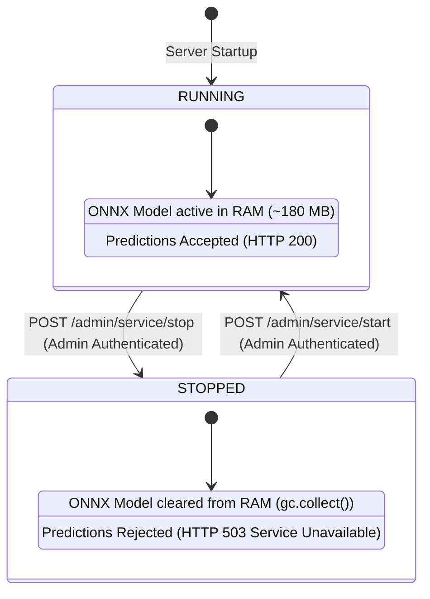

# 05 — Backend & FastAPI Service Deep Dive

This document provides a comprehensive analysis of the **Cotton Guard** backend API server implemented in [`backend/main.py`](file:///E:/project/kushi/backend/main.py) and supported by [`backend/service_state.py`](file:///E:/project/kushi/backend/service_state.py).

---

## 1. Application Initialization & Server Execution

The backend is built upon **FastAPI** (`0.143.0`) and executed using the **Uvicorn** ASGI server. 

### Bootstrapping Sequence
1. **Module Path Resolution**: Adds the repository root and `backend/` directory to `sys.path`.
2. **Environment Loading**: Reads configuration variables from `.env` using `python-dotenv`.
3. **Database Initialization**: Invokes [`init_database()`](file:///E:/project/kushi/backend/database.py#L333), creating all tables and seeding the 7 canonical disease records.
4. **Model Loading & Callback Registration**:
   - Registers callback handlers (`load_inference_session` and `unload_inference_session`) with [`service_state`](file:///E:/project/kushi/backend/service_state.py#L13).
   - If the service is marked as running, it immediately loads [`cotton_guard_model.onnx`](file:///E:/project/kushi/ml/models/cotton_guard_model.onnx) into memory using the ONNX Runtime `CPUExecutionProvider`.
5. **CORS Middleware**: Enables cross-origin resource sharing (`allow_origins=["*"]`) for communication with mobile clients and diagnostic web tools.

### Port & Binding Strategy
- In [`run_server.py`](file:///E:/project/kushi/backend/run_server.py#L11-L12), the server reads `HOST` (default `0.0.0.0`) and `PORT` (default `7860`).
- Port **7860** satisfies Hugging Face Spaces and container standards, while also supporting local binding for Android emulators (`10.0.2.2:8000`) and LAN devices.

---

## 2. API Endpoint Architecture

All primary routes are dual-mapped with both a root path (e.g. `/predict`) and an authoritative versioned prefix (e.g. `/api/v1/predict`):

```
┌────────────────────────────────────────────────────────────────────────┐
│                              FASTAPI APP                               │
├─────────────────────────┬──────────────────────┬───────────────────────┤
│ Core & Health           │ Diagnostic & Crop    │ Auth & Administration │
├─────────────────────────┼──────────────────────┼───────────────────────┤
│ GET /                   │ POST /predict        │ POST /auth/register   │
│ GET /api/v1             │ POST /api/v1/predict │ POST /auth/login      │
│ GET /health             │ GET /advisory/all    │ POST /auth/google     │
│ GET /api/v1/health      │ GET /disease/{name}  │ GET /auth/me          │
│                         │ GET /fields          │ POST /auth/forgot-pw  │
│                         │                      │ POST /auth/reset-pw   │
│                         │                      │ GET /admin/state      │
│                         │                      │ POST /admin/start     │
│                         │                      │ POST /admin/stop      │
│                         │                      │ GET /admin/logs       │
└─────────────────────────┴──────────────────────┴───────────────────────┘
```

---

## 3. Deep Dive: Diagnostic Inference Pipeline (`POST /api/v1/predict`)

The core diagnostic endpoint implements a sequential 5-stage pipeline designed for botanical safety and computational efficiency:

```
Upload Stream ──► [Stage 1: Payload & Bytes] ──► [Stage 2: Photometric Exposure]
                                                           │
                                                           ▼
[Stage 5: SQLite/Postgres DB] ◄── [Stage 4: ONNX Inference] ◄── [Stage 3: Botanical HSV Mask]
```

### Stage 1: Payload & Byte Verification
- Reads incoming file bytes via `await file.read()`.
- Rejects files exceeding `MAX_UPLOAD_SIZE_MB` (default **15 MB**) with HTTP 413.
- Verifies that file size is at least 200 bytes and checks image file signature (JPEG, PNG, WEBP).
- Safely decodes into a PIL `Image` object via [`CottonDomainGate.validate_file_payload()`](file:///E:/project/kushi/ml/cotton_gate.py#L38).

### Stage 2: Photometric Quality Gating
- Calculates mean luminance ($\mu = 0.299R + 0.587G + 0.114B$). Rejects images where $\mu < 30.0$ (too dark) or $\mu > 245.0$ (washed out).
- Computes sharpness via Laplacian variance. Rejects images with blur score $< 15.0$ with HTTP 422 (`POOR_QUALITY`).

### Stage 3: Botanical Foliage & Cotton-Domain Screening
- Converts image to HSV color space.
- Applies a multi-chromatic foliage mask capturing:
  - Green chlorophyll ($H \in [30, 115], S > 35, V > 25$)
  - Chlorotic yellowing ($H \in [15, 30], S > 35, V > 30$)
  - Anthocyanosis reddening ($H < 15 \lor H > 230, S > 40, V > 25$)
  - Necrotic lesions ($H \in [10, 25], S \in [25, 180], V \in [20, 150]$)
- Rejects frames where foliage coverage is below **15%** or texture energy is below **10.0** with HTTP 422 (`NON_COTTON`).

### Stage 4: Deep Learning Inference & Uncertainty Assessment
- Preprocesses image using CIELAB-CLAHE and ImageNet normalization.
- Runs inference via ONNX Runtime session:
  ```python
  ort_inputs = {ORT_SESSION.get_inputs()[0].name: input_tensor}
  logits = ORT_SESSION.run(None, ort_inputs)[0][0]
  ```
- Normalizes logits to probabilities using numerically stable softmax:
  $$\text{Softmax}(z_i) = \frac{e^{z_i - \max(z)}}{\sum_j e^{z_j - \max(z)}}$$
- Evaluates prediction uncertainty via [`CottonDomainGate.evaluate_prediction_uncertainty()`](file:///E:/project/kushi/ml/cotton_gate.py#L224):
  - Flags prediction if top-1 confidence is below **0.55**.
  - Flags prediction if top-1 and top-2 margin is below **0.12**.

### Stage 5: Agronomic Knowledge Base Retrieval
- Queries [`get_advisory_for_class()`](file:///E:/project/kushi/backend/database.py#L612) using the predicted canonical class name.
- Retrieves symptoms, prevention methods, chemical cures, and severity ratings.
- **Safety Rule**: If uncertainty was flagged, chemical pesticide recommendations are suppressed and replaced with safe agronomic guidance advising field consultation at the local KVK.

---

## 4. Administrative Control Plane (`backend/service_state.py`)

To allow administrators to manage memory consumption on free-tier containers and pause inference during maintenance, the backend incorporates a state coordinator:



### Key Administrative Features:
1. **Dynamic Memory Reclamation**: When stopped, `ORT_SESSION` is set to `None` and `gc.collect()` is invoked, freeing ~180 MB of RAM on memory-constrained hosts.
2. **Predict Rejection**: When paused or stopped, `/predict` immediately returns **HTTP 503 Service Unavailable** with an informative explanation.
3. **Audit Logging**: Every state change is recorded in the `service_audit_logs` table via [`log_service_action()`](file:///E:/project/kushi/backend/database.py#L933), recording timestamp, caller identity, prior state, and transition details.
4. **Strict Authorization**: Enforced by [`verify_admin_authorization()`](file:///E:/project/kushi/backend/main.py#L755), requiring either an authenticated administrator session token or an `X-Admin-Key` header matching `ADMIN_API_KEY`.
