# 06 — Machine Learning & Inference Pipeline

This document provides a thorough scientific explanation of the machine learning architecture, dataset provenance, preprocessing transformations, attention mechanisms, ONNX conversion, and empirical performance metrics in **Cotton Guard**.

---

## 1. Dataset Provenance & Data Partitioning

### SAR-CLD-2024 Dataset
The production model was trained and evaluated on the authentic **SAR-CLD-2024** agricultural dataset:
- **Title**: *SAR-CLD-2024: A Comprehensive Dataset for Cotton Leaf Disease Detection*
- **Source**: Mendeley Data (DOI: `10.17632/b3jy2p6k8w.2`)
- **Total Authentic Original Images**: **2,137 images** across 7 canonical foliar conditions.

### Stratified Partitioning Strategy
To prevent data leakage, near-duplicate images and consecutive camera bursts were strictly isolated:
- **Training Set (70%)**: **1,493 images**
- **Validation Set (15%)**: **322 images** (used exclusively for hyperparameter tuning and model selection)
- **Holdout Test Set (15%)**: **322 images** (evaluated once; zero data leakage)

---

## 2. Canonical Disease Classes

The model classifies cotton leaves into exactly **7 mutually exclusive canonical classes**:

| # | Canonical Class Name | Scientific / Agronomic Classification | Pathogen / Vector / Abiotic Cause |
| :---: | :--- | :--- | :--- |
| **0** | **Bacterial Blight** | *Xanthomonas citri pv. malvacearum* | Bacterial pathogen (angular water-soaked lesions) |
| **1** | **Cotton Leaf Curl Virus** | *Begomovirus* (CLCuV) | Viral pathogen transmitted by Whitefly (*Bemisia tabaci*) |
| **2** | **Healthy Leaf** | *Gossypium hirsutum L.* | Vigorous, lesion-free cotton foliage |
| **3** | **Herbicide Growth Damage** | Physiological phytotoxicity | Chemical spray drift (2,4-D / glyphosate damage) |
| **4** | **Leaf Hopper / Jassids** | *Amrasca biguttula biguttula* | Sucking insect pest causing hopper burn |
| **5** | **Leaf Reddening** | Physiological anthocyanosis | Magnesium deficiency, waterlogging, cold stress |
| **6** | **Leaf Variegation** | Genetic / plastid chimera | Benign non-pathogenic sectoral chlorophyll mutation |

---

## 3. Preprocessing: CIELAB-CLAHE & Normalization

Standard RGB contrast enhancement frequently distorts chromatic hues essential for disease diagnosis. To overcome this, Cotton Guard employs a **hybrid CIELAB-CLAHE preprocessing pipeline** in [`ml/preprocessing.py`](file:///E:/project/kushi/ml/preprocessing.py):

```mermaid
flowchart LR
    RGB_IN["Input Leaf Image<br/>(RGB, variable size)"] --> RESIZE["Bilinear Resize<br/>(224 x 224 pixels)"]
    RESIZE --> BGR["Color Conversion<br/>(RGB to BGR for OpenCV)"]
    BGR --> LAB["Color Space Transform<br/>(BGR to CIELAB: L, a, b)"]
    LAB --> CLAHE["Luminance Equalization<br/>(CLAHE on L-channel:<br/>clipLimit=2.0, tileGrid=8x8)"]
    CLAHE --> LAB_MERGE["Channel Merge<br/>(Equalized L + Original a + Original b)"]
    LAB_MERGE --> RGB_OUT["Inverse Transform<br/>(CIELAB to RGB)"]
    RGB_OUT --> NORM["ImageNet Tensor Normalization<br/>mean=[0.485, 0.456, 0.406]<br/>std=[0.229, 0.224, 0.225]"]
    NORM --> TENSOR["Output Float32 Tensor<br/>(1, 3, 224, 224)"]
```



### Mathematical Formulation
1. **Luminance Isolation**: The image is mapped to the CIELAB color space where the $L^*$ channel represents perceptual lightness (0–100), while $a^*$ (green to red) and $b^*$ (blue to yellow) contain chromatic information.
2. **Adaptive Equalization**: CLAHE limits amplification of background field noise by clipping histogram counts above $\beta = 2.0$ within localized $8 \times 8$ grid tiles:
   $$H_k^{\text{clipped}} = \min(H_k, \beta)$$
3. **Hue Preservation**: By restricting equalization to the $L^*$ channel, subtle disease cues (e.g., leaf reddening anthocyanin pigments and jassid marginal yellowing) are enhanced without color distortion.

---

## 4. Deep Learning Architecture: MobileNetV3-Large + CBAM

The neural network utilizes a **MobileNetV3-Large** backbone enhanced with a **Convolutional Block Attention Module ([`CBAM`](file:///E:/project/kushi/ml/cbam.py))**:

```
Input Tensor (3 x 224 x 224)
        │
        ▼
MobileNetV3-Large Backbone (Inverted Residual Blocks, Hard-Swish)
        │
        ▼ (960 Feature Maps x 7 x 7)
┌──────────────────────────────────────────────────────────────┐
│ CBAM Attention Module                                        │
│  1. Channel Attention: Mc(F) = σ(MLP(AvgPool) + MLP(MaxPool)) │
│  2. Spatial Attention: Ms(F') = σ(f7x7([AvgPool; MaxPool]))   │
└───────────────────────┬──────────────────────────────────────┘
                        │
                        ▼ (960 Feature Maps, Attention-Weighted)
Adaptive Average Pooling (960 x 1 x 1)
                        │
                        ▼
Linear Projection (960 ──► 1280) with Hard-Swish & Dropout (0.2)
                        │
                        ▼
Classification Head (1280 ──► 7 Class Logits)
```

### Convolutional Block Attention Module ([`CBAM`](file:///E:/project/kushi/ml/cbam.py#L14-L65))
CBAM infers attention maps sequentially along channel and spatial dimensions:

1. **Channel Attention ([`ChannelAttention`](file:///E:/project/kushi/ml/cbam.py#L14-L37))**: Computes *what* disease features are meaningful:
   $$\mathbf{M}_c(\mathbf{F}) = \sigma\left(\mathbf{W}_1\left(\mathbf{W}_0(\mathbf{F}_{\text{avg}}^c)\right) + \mathbf{W}_1\left(\mathbf{W}_0(\mathbf{F}_{\text{max}}^c)\right)\right)$$
   Where $\mathbf{W}_0 \in \mathbb{R}^{\frac{C}{r} \times C}$ and $\mathbf{W}_1 \in \mathbb{R}^{C \times \frac{C}{r}}$ represent a shared MLP with reduction ratio $r=16$.

2. **Spatial Attention ([`SpatialAttention`](file:///E:/project/kushi/ml/cbam.py#L39-L65))**: Computes *where* foliar lesions are located:
   $$\mathbf{M}_s(\mathbf{F}') = \sigma\left(f^{7 \times 7}\left(\left[\mathbf{F}_{\text{avg}}'^s; \, \mathbf{F}_{\text{max}}'^s\right]\right)\right)$$
   Where $f^{7 \times 7}$ denotes a 2D convolution with a $7 \times 7$ kernel and sigmoid activation $\sigma$.

---

## 5. Model Selection & Ablation Study

During model exploration on the 322 authentic validation images, five candidate configurations were evaluated:

| Experiment ID | Backbone | Preprocessing | Attention | Loss Function | Val Acc | Val Macro F1 | Val LHJ Recall |
| :--- | :--- | :--- | :--- | :--- | :---: | :---: | :---: |
| **Exp 1** | MobileNetV2 | Standard RGB | None | Standard CE | 92.55% | 0.9170 | 76.5% |
| **Exp 2** | MobileNetV2 | CIELAB-CLAHE | CBAM | Standard CE | 92.86% | 0.9249 | 76.5% |
| **Exp 3** | MobileNetV2 | CIELAB-CLAHE | CBAM | Class-Weighted CE | 93.48% | 0.9326 | 79.4% |
| **Exp 4** | MobileNetV2 | CIELAB-CLAHE | CBAM | Focal Loss ($\gamma=1.5$) | 92.55% | 0.9227 | 76.5% |
| **Exp 5 (Selected)** | **MobileNetV3-Large** | **CIELAB-CLAHE** | **CBAM** | **Class-Weighted CE** | **94.72%** | **0.9477** | **82.4%** |

**Selection Rationale**: Exp 5 demonstrated superior overall generalization, highest validation macro-F1 (0.9477), and the best recall on the hardest minority class (`Leaf Hopper / Jassids` at 82.4%).

---

## 6. Holdout Test Set Evaluation (322 Authentic Images)

Following selection, the production model was evaluated against the **322 untouched authentic holdout test images**:

```
[TEST EVALUATION SUMMARY - PRODUCTION MODEL]
--------------------------------------------------------------------------------
Total Test Images Evaluated     : 322 Authentic Images (0% Data Leakage)
Overall Accuracy                : 91.93% (296 / 322 Correct)
Balanced Accuracy               : 91.40%
Macro Precision                 : 92.04%
Macro Recall                    : 91.40%
Macro F1-Score                  : 0.9138
Weighted F1-Score               : 0.9172
Mean CPU Inference Latency      : 18.35 ms
--------------------------------------------------------------------------------
```

### Detailed Per-Class Metrics

| Canonical Class Name | Precision | Recall | F1-Score | Support |
| :--- | :---: | :---: | :---: | :---: |
| **Bacterial Blight** | 86.8% | 86.8% | 0.868 | 38 |
| **Cotton Leaf Curl Virus** | 87.7% | 98.5% | 0.928 | 65 |
| **Healthy Leaf** | 88.1% | 94.9% | 0.914 | 39 |
| **Herbicide Growth Damage** | 100.0% | 100.0% | 1.000 | 42 |
| **Leaf Hopper / Jassids** | 92.0% | 67.6% | 0.780 | 34 |
| **Leaf Reddening** | 95.2% | 92.0% | 0.936 | 87 |
| **Leaf Variegation** | 94.4% | 100.0% | 0.971 | 17 |
| **Macro Average** | **92.0%** | **91.4%** | **0.914** | **322** |
| **Weighted Average** | **92.1%** | **91.9%** | **0.917** | **322** |

### Confusion Matrix (Test Set)

```
                            PREDICTED CLASS
True Class       BB   CLCuV   HL   HGD   LHJ   LR   LV   Total
--------------------------------------------------------------
Bacterial Blight [ 33     2     2     0     0    1    0 ]   38
Curl Virus       [  0    64     1     0     0    0    0 ]   65
Healthy Leaf     [  0     1    37     0     1    0    0 ]   39
Herbicide Damage [  0     0     0    42     0    0    0 ]   42
LHJ (Jassids)    [  1     5     2     0    23    3    0 ]   34
Leaf Reddening   [  4     1     0     0     1   80    1 ]   87
Leaf Variegation [  0     0     0     0     0    0   17 ]   17
--------------------------------------------------------------
TOTALS           [ 38    73    42    42    25   84   18 ]  322
```

---

## 7. ONNX Export & Parity Verification

The model was converted to ONNX format with dynamic batch sizing:
- **ONNX Model Path**: [`ml/models/cotton_guard_model.onnx`](file:///E:/project/kushi/ml/models/cotton_guard_model.onnx) (17.3 MB)
- **PyTorch Checkpoint**: [`ml/models/cotton_guard_model.pt`](file:///E:/project/kushi/ml/models/cotton_guard_model.pt) (17.5 MB)
- **Class Match Rate**: **100.0%** (100 out of 100 benchmark images yielded identical argmax predictions).
- **Max Output Divergence**: $6.74 \times 10^{-6}$ (floating-point tolerance).
- **CPU Execution Provider**: Sub-20ms inference latency across typical host environments.
