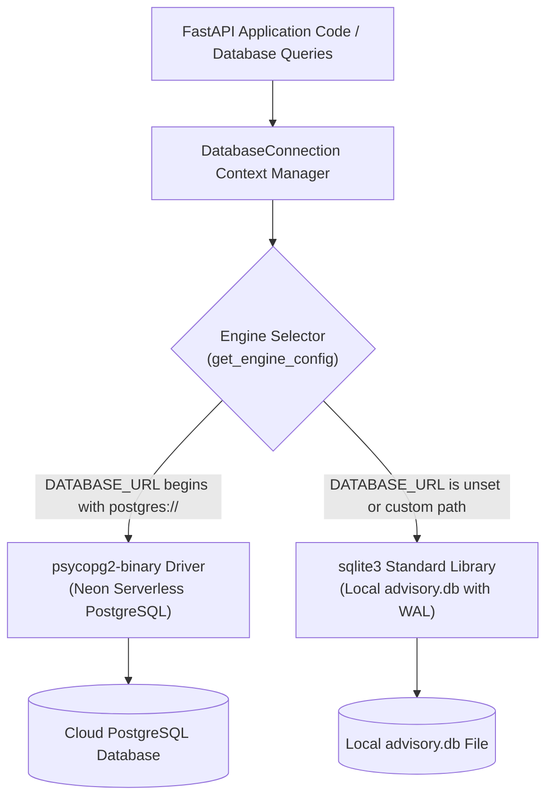
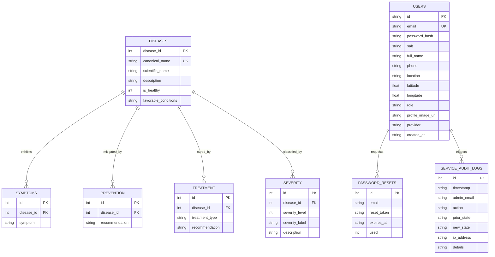

# 07 — Database Architecture & Data Model

This document details the database architecture, schema definitions, relational integrity, dual-engine abstraction, and data seeding mechanisms implemented in [`backend/database.py`](file:///E:/project/kushi/backend/database.py).

---

## 1. Dual-Engine Architectural Design

Cotton Guard implements a **dual-engine database layer** that provides unified access across local file-based SQLite and cloud serverless PostgreSQL without modifying application-level code:



### Abstraction Mechanics ([`DatabaseConnection`](file:///E:/project/kushi/backend/database.py#L76-L160))
1. **Dynamic Engine Selection**: Evaluates connection parameters in [`get_engine_config()`](file:///E:/project/kushi/backend/database.py#L50-L74), defaulting to SQLite unless `DATABASE_URL` specifies a PostgreSQL connection string.
2. **SQL Dialect Normalization**: Automatically converts SQLite parameter placeholders (`?`) to PostgreSQL placeholders (`%s`) via `_prepare_sql()`.
3. **Primary Key Retrieval**: Implements [`execute_insert()`](file:///E:/project/kushi/backend/database.py#L140-L159), appending `RETURNING id` for PostgreSQL and inspecting `cursor.lastrowid` for SQLite.
4. **Dictionary Row Factory**: Maps PostgreSQL rows via `psycopg2.extras.RealDictCursor` and SQLite rows via `sqlite3.Row`, returning identical Python dictionary mappings.

---

## 2. Entity-Relationship Diagram (ERD)



---

## 3. Schema Definitions (DDL)

### 1. SQLite Schema ([`SQLITE_SCHEMA`](file:///E:/project/kushi/backend/database.py#L162-L248))
```sql
PRAGMA journal_mode=WAL;
PRAGMA busy_timeout=5000;

CREATE TABLE IF NOT EXISTS diseases (
    disease_id INTEGER PRIMARY KEY AUTOINCREMENT,
    canonical_name TEXT UNIQUE NOT NULL,
    scientific_name TEXT NOT NULL,
    description TEXT NOT NULL,
    is_healthy INTEGER NOT NULL DEFAULT 0,
    favorable_conditions TEXT
);

CREATE TABLE IF NOT EXISTS symptoms (
    id INTEGER PRIMARY KEY AUTOINCREMENT,
    disease_id INTEGER NOT NULL,
    symptom TEXT NOT NULL,
    FOREIGN KEY (disease_id) REFERENCES diseases (disease_id) ON DELETE CASCADE
);

CREATE TABLE IF NOT EXISTS prevention (
    id INTEGER PRIMARY KEY AUTOINCREMENT,
    disease_id INTEGER NOT NULL,
    recommendation TEXT NOT NULL,
    FOREIGN KEY (disease_id) REFERENCES diseases (disease_id) ON DELETE CASCADE
);

CREATE TABLE IF NOT EXISTS treatment (
    id INTEGER PRIMARY KEY AUTOINCREMENT,
    disease_id INTEGER NOT NULL,
    treatment_type TEXT DEFAULT 'Chemical',
    recommendation TEXT NOT NULL,
    FOREIGN KEY (disease_id) REFERENCES diseases (disease_id) ON DELETE CASCADE
);

CREATE TABLE IF NOT EXISTS severity (
    id INTEGER PRIMARY KEY AUTOINCREMENT,
    disease_id INTEGER NOT NULL,
    severity_level INTEGER NOT NULL,
    severity_label TEXT NOT NULL,
    description TEXT NOT NULL,
    FOREIGN KEY (disease_id) REFERENCES diseases (disease_id) ON DELETE CASCADE
);

CREATE TABLE IF NOT EXISTS users (
    id TEXT PRIMARY KEY,
    email TEXT UNIQUE NOT NULL,
    password_hash TEXT,
    salt TEXT,
    full_name TEXT NOT NULL,
    phone TEXT DEFAULT '',
    location TEXT DEFAULT 'Warangal, Telangana',
    latitude REAL,
    longitude REAL,
    role TEXT DEFAULT 'Cotton Farmer',
    profile_image_url TEXT,
    provider TEXT DEFAULT 'email',
    created_at TEXT NOT NULL
);

CREATE TABLE IF NOT EXISTS password_resets (
    id INTEGER PRIMARY KEY AUTOINCREMENT,
    email TEXT NOT NULL,
    reset_token TEXT NOT NULL,
    expires_at TEXT NOT NULL,
    used INTEGER DEFAULT 0
);

CREATE TABLE IF NOT EXISTS service_audit_logs (
    id INTEGER PRIMARY KEY AUTOINCREMENT,
    timestamp TEXT NOT NULL,
    admin_email TEXT NOT NULL,
    action TEXT NOT NULL,
    prior_state TEXT NOT NULL,
    new_state TEXT NOT NULL,
    ip_address TEXT DEFAULT '',
    details TEXT DEFAULT ''
);
```

### 2. PostgreSQL Schema ([`POSTGRES_SCHEMA`](file:///E:/project/kushi/backend/database.py#L250-L330))
The PostgreSQL DDL mirrors the table structure with native type mappings:
- Auto-increment columns use `SERIAL PRIMARY KEY`.
- Foreign keys declare explicit relational integrity: `REFERENCES diseases (disease_id) ON DELETE CASCADE`.
- Real numbers map to native `REAL` and text columns use native `TEXT`.

---

## 4. Idempotent Data Seeding & Knowledge Base Initialization

The database initialization routine in [`init_database()`](file:///E:/project/kushi/backend/database.py#L333-L578) runs automatically on every application boot.

### Guarantees of `init_database()`:
1. **Idempotent Disease Upsert**: Uses `INSERT ... ON CONFLICT (canonical_name) DO UPDATE` to refresh botanical descriptions without duplicating records.
2. **Cascading Child Cleanup**: Deletes and re-inserts child rows in `symptoms`, `prevention`, `treatment`, and `severity` for that disease ID, ensuring latest agronomic guidelines are active.
3. **User Data Isolation**: Never alters or truncates the `users`, `password_resets`, or `service_audit_logs` tables.
4. **Non-Destructive Admin Provisioning**: Promotes existing administrators via [`provision_initial_admin()`](file:///E:/project/kushi/backend/database.py#L850) without resetting their passwords upon restart.

---

## 5. Agronomic Knowledge Retrieval API

Class-based retrieval is performed by [`get_advisory_for_class()`](file:///E:/project/kushi/backend/database.py#L612-L675):
1. **Alias Resolution**: Resolves variations (e.g. `"leaf_redding"` or `"curl virus"`) to the authoritative canonical name via [`resolve_canonical_class()`](file:///E:/project/kushi/backend/database.py#L607).
2. **Relational Query**: Fetches base metadata from `diseases`, joining corresponding child lists from `symptoms`, `prevention`, `treatment`, and `severity`.
3. **Structured Response**: Returns an assembled JSON dictionary matching the frontend [`PredictionResult`](file:///E:/project/kushi/lib/models/prediction_result.dart) schema.
