# 08 — Authentication, Authorization & Security Posture

This document provides a thorough security review of the authentication systems, role-based access controls, cryptographic implementations, and fail-closed security policies in **Cotton Guard**.

---

## 1. Threat Model & Security Posture

Cotton Guard operates in an agricultural context with sensitive user data, machine learning resources, and server state controls. The security architecture addresses the following threat vectors:
1. **Privilege Escalation**: Untrusted actors registering accounts with self-assigned administrative privileges.
2. **Unauthorized State Manipulation**: Unauthenticated attackers stopping the inference service or tampering with audit logs.
3. **Credential Harvesting & Tampering**: Brute-force attacks against user passwords or forging session tokens.
4. **OAuth Token Forgery**: Malicious actors sending arbitrary user profiles claiming Google verification.
5. **Secret Exposure**: Hardcoded production secrets or database files leaked into source control.

---

## 2. User Authentication & Password Security

### Password Hashing Implementation
User passwords are encrypted using **PBKDF2-HMAC-SHA256** with **100,000 iterations** and a **128-bit random salt** in [`hash_password()`](file:///E:/project/kushi/backend/database.py#L697-L707):
```python
def hash_password(password: str, salt: Optional[str] = None) -> Tuple[str, str]:
    if not salt:
        salt = secrets.token_hex(16)
    pw_hash = hashlib.pbkdf2_hmac(
        'sha256',
        password.encode('utf-8'),
        salt.encode('utf-8'),
        100000
    ).hex()
    return pw_hash, salt
```

### Constant-Time Password Verification
Password matching uses constant-time string comparison via [`secrets.compare_digest()`](file:///E:/project/kushi/backend/database.py#L709-L713) to mitigate side-channel timing attacks:
```python
def verify_password(password: str, pw_hash: str, salt: str) -> bool:
    candidate_hash, _ = hash_password(password, salt)
    return secrets.compare_digest(candidate_hash, pw_hash)
```

---

## 3. Session Management & Cryptographic Token Signing

Session authentication is handled by cryptographic **HMAC-SHA256 signed session tokens** in [`generate_session_token()`](file:///E:/project/kushi/backend/database.py#L714-L724):

```
┌───────────────────────────────────────┐   ┌────────────────────────────────────────┐
│ Payload (URL-Safe Base64 JSON)        │ . │ Signature (HMAC-SHA256 Hex Digest)     │
│  - uid: user_id                       │   │  - Recomputed over payload_b64 using   │
│  - email: user_email                  │   │    COTTON_GUARD_SECRET_KEY             │
│  - exp: timestamp + 30 days           │   │  - Verified with secrets.compare_digest│
└───────────────────────────────────────┘   └────────────────────────────────────────┘
```

### Fail-Closed Secret Key Policy
The signing secret is managed by [`get_secret_key()`](file:///E:/project/kushi/backend/database.py#L24-L47):
- **Production Mode**: Requires `COTTON_GUARD_SECRET_KEY` in environment variables with a minimum length of 32 characters. Fails immediately on startup with a `RuntimeError` if missing or set to an insecure default.
- **Development Mode**: Generates an ephemeral secure random 256-bit token (`secrets.token_hex(32)`) if unset.

---

## 4. Role-Based Access Control (RBAC) & Registration Safeguards

### Public Registration Role Restriction
To prevent unauthorized privilege acquisition, [`register_user_endpoint()`](file:///E:/project/kushi/backend/main.py#L523-L564) implements strict role gating:
1. **Explicit Rejection**: If `req.role` requests a privileged role (`"System Admin"`, `"Admin"`, `"Administrator"`, or `"Super Admin"`), the request is rejected immediately with **HTTP 403 Forbidden**.
2. **Default Role Enforcement**: All self-registered users are strictly assigned the `"Cotton Farmer"` role, regardless of any other input field.

### First-Admin Provisioning
Administrative accounts cannot be created via public registration. Instead, administrators are provisioned via [`provision_initial_admin()`](file:///E:/project/kushi/backend/database.py#L850-L893):
- Reads `ADMIN_EMAIL` and `ADMIN_INITIAL_PASSWORD` from environment variables during startup.
- If the account already exists, its role is verified as `"System Admin"` without altering the existing password.
- Can be invoked from the CLI using [`backend/provision_admin.py`](file:///E:/project/kushi/backend/provision_admin.py).

---

## 5. Google OAuth 2.0 Verification Pipeline

Google Sign-In integration does not rely on client-supplied profile claims. Instead, the backend cryptographically verifies the Google ID token via [`verify_google_id_token()`](file:///E:/project/kushi/backend/main.py#L590-L654):

```mermaid
sequenceDiagram
    autonumber
    participant App as Mobile App
    participant Backend as FastAPI Server
    participant Google as Google OAuth Tokeninfo API

    App->>Backend: POST /api/v1/auth/google {id_token: "..."}
    Backend->>Google: GET https://oauth2.googleapis.com/tokeninfo?id_token=...
    Google-->>Backend: HTTP 200 {iss, aud, exp, email, email_verified, name, picture}
    
    rect rgb(25, 25, 35)
        Note over Backend: 5-Point Cryptographic Validation
        Backend->>Backend: 1. Verify issuer is accounts.google.com
        Backend->>Backend: 2. Verify audience matches GOOGLE_CLIENT_ID
        Backend->>Backend: 3. Verify token has not expired (exp > now)
        Backend->>Backend: 4. Verify email_verified is true
        Backend->>Backend: 5. Extract verified email and name
    end

    Backend->>Backend: Create or get user with role="Cotton Farmer"
    Backend-->>App: Return session token & clean user profile
```



---

## 6. Admin Control Plane Authorization

Administrative operations (`/admin/service/state`, `/admin/service/start`, `/admin/service/stop`, `/admin/service/logs`) are guarded by [`verify_admin_authorization()`](file:///E:/project/kushi/backend/main.py#L755-L788):

```python
def verify_admin_authorization(
    authorization: Optional[str] = Header(None),
    x_admin_key: Optional[str] = Header(None, alias="X-Admin-Key")
) -> str:
    # Option 1: X-Admin-Key header matching ADMIN_API_KEY
    current_admin_key = os.environ.get("ADMIN_API_KEY", ADMIN_API_KEY).strip()
    if current_admin_key and x_admin_key and secrets.compare_digest(x_admin_key.strip(), current_admin_key):
        return "admin_key"

    # Option 2: Bearer session token belonging to verified admin
    current_admin_email = os.environ.get("ADMIN_EMAIL", ADMIN_EMAIL).strip().lower()
    if authorization and authorization.startswith("Bearer "):
        token = authorization.split("Bearer ")[1].strip()
        payload = verify_session_token(token)
        if payload:
            user = get_user_by_id(payload.get("uid", ""))
            if user:
                user_email = user.get("email", "").lower()
                user_role = user.get("role", "")
                if user_role in ["System Admin", "Admin"] and (not current_admin_email or user_email == current_admin_email):
                    return user_email

    # Fail closed: No development or unauthenticated bypass
    raise HTTPException(
        status_code=status.HTTP_403_FORBIDDEN,
        detail="Administrator privilege required. Valid administrator credentials must be provided."
    )
```

---

## 7. Network & Repository Security Controls

1. **Cleartext Traffic Policy ([`network_security_config.xml`](file:///E:/project/kushi/android/app/src/main/res/xml/network_security_config.xml))**:
   - Cleartext HTTP is restricted to local development addresses (`10.0.2.2`, `127.0.0.1`, `localhost`).
   - Production cloud endpoints enforce HTTPS.
2. **Git & Docker Leak Prevention**:
   - Both [`.gitignore`](file:///E:/project/kushi/.gitignore) and [`.dockerignore`](file:///E:/project/kushi/.dockerignore) exclude all `.env` files, `.db` SQLite databases, Android `.keystore` / `key.properties` files, and raw dataset directories.
   - Verified: No secrets, passwords, or local databases are tracked in the Git repository.
