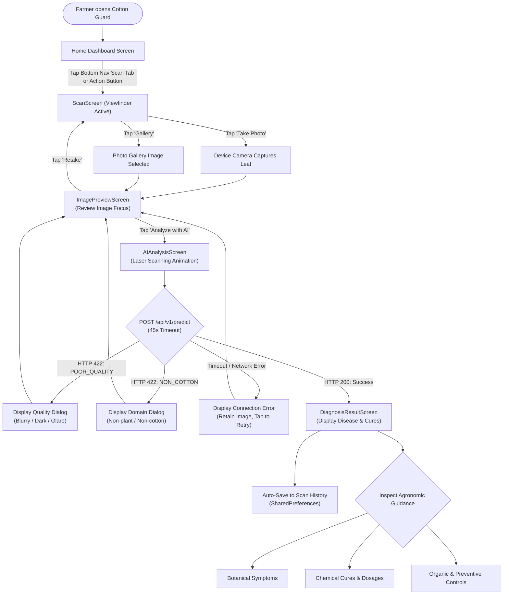
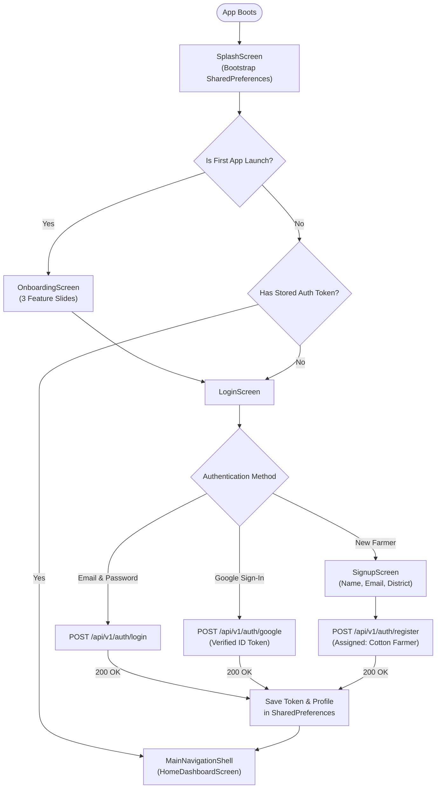
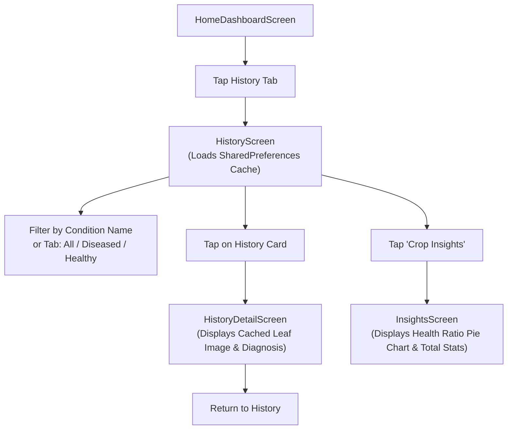
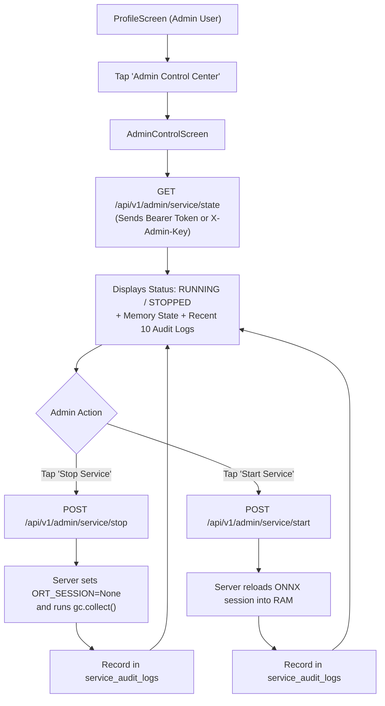

# 11 — Features Inventory & End-to-End User Flows

This document details the functional feature inventory and user journeys implemented in the **Cotton Guard** application.

---

## 1. Complete Feature Inventory

| Module | Feature Name | Description | Key Source Files |
| :--- | :--- | :--- | :--- |
| **Scanning & AI** | **Camera Viewfinder** | Responsive viewfinder with animated corner brackets, crop guides, and non-overlapping action buttons. | [`lib/screens/scan/scan_screen.dart`](file:///E:/project/kushi/lib/screens/scan/scan_screen.dart) |
| **Scanning & AI** | **Image Confirmation** | Pre-upload review screen enabling farmers to verify focus or retake before calling AI API. | [`lib/screens/scan/image_preview_screen.dart`](file:///E:/project/kushi/lib/screens/scan/image_preview_screen.dart) |
| **Scanning & AI** | **Real-Time Analysis Animation** | Multi-phase animated scanning reticle with live status feedback during inference. | [`lib/screens/scan/ai_analysis_screen.dart`](file:///E:/project/kushi/lib/screens/scan/ai_analysis_screen.dart) |
| **Scanning & AI** | **Comprehensive Diagnosis** | Common name, scientific name, confidence meter, severity pill, and favorable weather triggers. | [`lib/screens/scan/diagnosis_result_screen.dart`](file:///E:/project/kushi/lib/screens/scan/diagnosis_result_screen.dart) |
| **Scanning & AI** | **Tabbed Agronomic Guidance** | Structured separation between Botanical Symptoms, Chemical Cures, and Organic/Prevention practices. | [`lib/screens/scan/diagnosis_result_screen.dart`](file:///E:/project/kushi/lib/screens/scan/diagnosis_result_screen.dart) |
| **Crop History** | **Local Scan Caching** | Persistent client-side archive of past scans with thumbnail images, dates, and diagnoses. | [`lib/screens/history/history_screen.dart`](file:///E:/project/kushi/lib/screens/history/history_screen.dart) |
| **Crop History** | **History Filtering & Search** | Instant text search and tabs for All Scans, Diseased, and Healthy leaves. | [`lib/screens/history/history_screen.dart`](file:///E:/project/kushi/lib/screens/history/history_screen.dart) |
| **Crop History** | **Historical Report Re-Inspection** | Re-opens archived diagnosis reports with complete chemical and organic advisories intact. | [`lib/screens/history/history_detail_screen.dart`](file:///E:/project/kushi/lib/screens/history/history_detail_screen.dart) |
| **Crop Health** | **Crop Health Insights** | Visual breakdown of overall crop health, diseased vs healthy ratios, and common disease frequencies. | [`lib/screens/insights/insights_screen.dart`](file:///E:/project/kushi/lib/screens/insights/insights_screen.dart) |
| **Reference** | **Disease Library Grid** | Clean visual catalog of the 7 canonical cotton foliar conditions without distracting severity tags. | [`lib/screens/disease_library/disease_library_screen.dart`](file:///E:/project/kushi/lib/screens/disease_library/disease_library_screen.dart) |
| **Reference** | **Agronomic Disease Profiles** | Deep encyclopedia entry for each disease covering biology, spread mechanisms, and controls. | [`lib/screens/disease_library/disease_detail_screen.dart`](file:///E:/project/kushi/lib/screens/disease_library/disease_detail_screen.dart) |
| **Advisory** | **Agronomic Care Guides** | General field management guides: Irrigation stages, split nitrogen schedules, sticky trap IPM, weed sanitation. | [`lib/screens/advisory/advisory_screen.dart`](file:///E:/project/kushi/lib/screens/advisory/advisory_screen.dart) |
| **Geography** | **Pan-India District Database** | Fast searchable picker covering 780+ districts across 28 states and 8 UTs with GPS coordinates. | [`lib/widgets/location_picker_sheet.dart`](file:///E:/project/kushi/lib/widgets/location_picker_sheet.dart) |
| **Weather** | **Open-Meteo Integration** | Live temperature, humidity, wind, rain probability, and localized crop disease risk alerts. | [`lib/services/weather_service.dart`](file:///E:/project/kushi/lib/services/weather_service.dart) |
| **Auth & Profile** | **Secure Farmer Sign-In** | Salted PBKDF2 email/password authentication and Google OAuth 2.0 integration. | [`lib/screens/auth/login_screen.dart`](file:///E:/project/kushi/lib/screens/auth/login_screen.dart) |
| **Auth & Profile** | **Farmer Profile Management** | Edit full name, contact phone, home district, and select profile picture stored locally. | [`lib/screens/profile/profile_screen.dart`](file:///E:/project/kushi/lib/screens/profile/profile_screen.dart) |
| **Settings** | **Server Connection Switcher** | Switch between Cloud Render, Android Emulator (10.0.2.2), Localhost, or custom IP with ping tests. | [`lib/screens/settings/server_connection_screen.dart`](file:///E:/project/kushi/lib/screens/settings/server_connection_screen.dart) |
| **Settings** | **Server Diagnostics** | Real-time display of round-trip latency, ONNX engine status, uptime, and supported classes. | [`lib/screens/settings/server_diagnostics_screen.dart`](file:///E:/project/kushi/lib/screens/settings/server_diagnostics_screen.dart) |
| **Admin** | **Service Control Panel** | Authenticated admin panel to start/stop the inference service and inspect audit logs. | [`lib/screens/settings/admin_control_screen.dart`](file:///E:/project/kushi/lib/screens/settings/admin_control_screen.dart) |

---

## 2. User Journey 1: Leaf Scanning & Disease Diagnosis

---

## 3. User Journey 2: Farmer Onboarding & Authentication

---

## 4. User Journey 3: Historical Review & Crop Analytics

---

## 5. User Journey 4: Administrative Service Control

