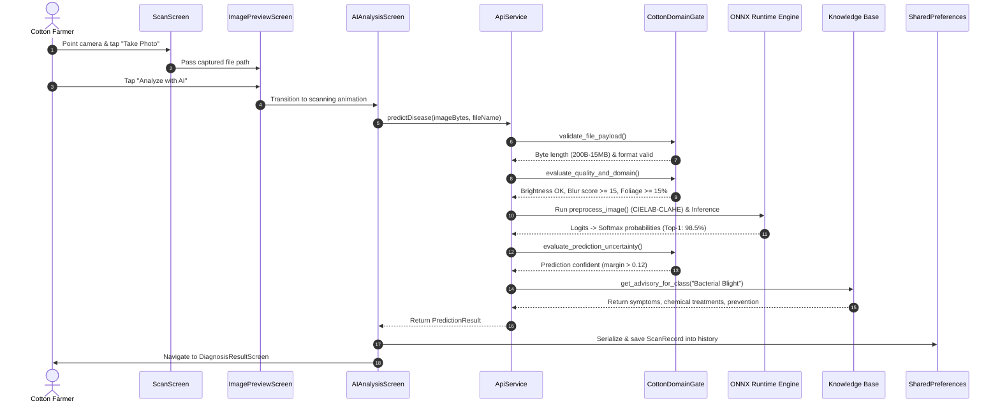
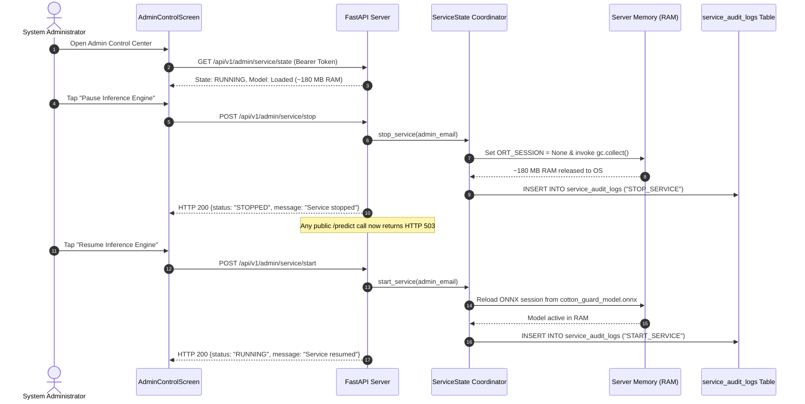
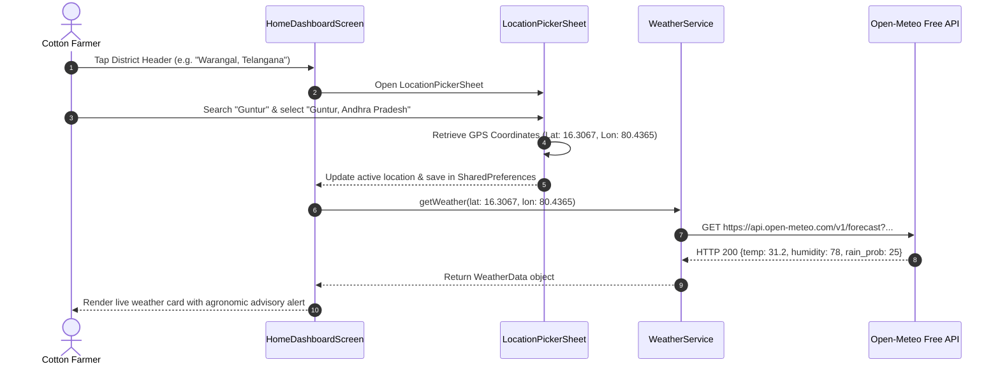

# 16 — End-to-End Execution Flows & Sequence Traces

This document provides detailed sequence diagrams and technical execution traces for the critical operational flows within **Cotton Guard**.

---

## Flow A: Cold-Start Request Lifecycle (Free-Tier Cloud Recovery)

```mermaid
sequenceDiagram
    autonumber
    actor Farmer as Cotton Farmer
    participant App as Mobile App
    participant Edge as Render Edge Gateway
    participant Container as Docker Container
    participant Backend as FastAPI / Uvicorn
    participant ONNX as ONNX Runtime
    participant DB as Neon PostgreSQL

    Farmer->>App: Tap "Analyze with AI"
    App->>App: Start 45s connection timer
    App->>Edge: POST /api/v1/predict (multipart)
    
    rect rgb(30, 20, 20)
        Note over Edge,Container: Container Cold Start (~30-40s)
        Edge->>Container: Spin up suspended Docker container
        Container->>Backend: Boot Uvicorn on 0.0.0.0:7860
        Backend->>DB: Connect via DATABASE_URL & run init_database()
        DB-->>Backend: Connection established (SSL)
        Backend->>ONNX: load_inference_session() (Load cotton_guard_model.onnx)
        ONNX-->>Backend: Session READY
        Backend-->>Edge: Container listener active on port 7860
    end
    
    Edge->>Backend: Forward queued POST /api/v1/predict request
    Backend->>Backend: Process image through 5-stage pipeline
    Backend-->>Edge: HTTP 200 OK (Prediction Result)
    Edge-->>App: Forward response
    App->>App: Cancel 45s timer & display DiagnosisResultScreen
    App-->>Farmer: Present diagnosis & agronomic spray advice
```



---

## Flow B: Normal Leaf Scanning & Prediction Sequence



---

## Flow C: Rejected Low-Quality & Non-Plant Scan Handling

```mermaid
sequenceDiagram
    autonumber
    actor Farmer as Cotton Farmer
    participant App as Mobile App
    participant Backend as FastAPI Server
    participant Gate as CottonDomainGate

    Farmer->>App: Captures blurry or non-plant image
    Farmer->>App: Taps "Analyze with AI"
    App->>Backend: POST /api/v1/predict
    
    Backend->>Gate: evaluate_quality_and_domain(image)
    
    alt Image is Blurry (Sharpness < 15.0)
        Gate-->>Backend: quality_passed: false (code: "POOR_QUALITY")
        Backend-->>App: HTTP 422 {code: "POOR_QUALITY", message: "Image is blurry..."}
        App-->>Farmer: Show Dialog: "Blurry Image. Hold camera steady and tap to focus."
    else Image is Non-Plant (Foliage Coverage < 15%)
        Gate-->>Backend: is_cotton_leaf: false (code: "NON_COTTON")
        Backend-->>App: HTTP 422 {code: "NON_COTTON", message: "Non-plant detected..."}
        App-->>Farmer: Show Dialog: "Unsupported Subject. Center a cotton leaf in frame."
    end
    
    Note over App,Farmer: User's image is retained in preview; zero re-capture friction
    Farmer->>App: Re-aligns camera and retries
```

---

## Flow D: Administrative Service Lifecycle & Memory Management



---

## Flow E: Weather Intelligence & District Selection Flow


