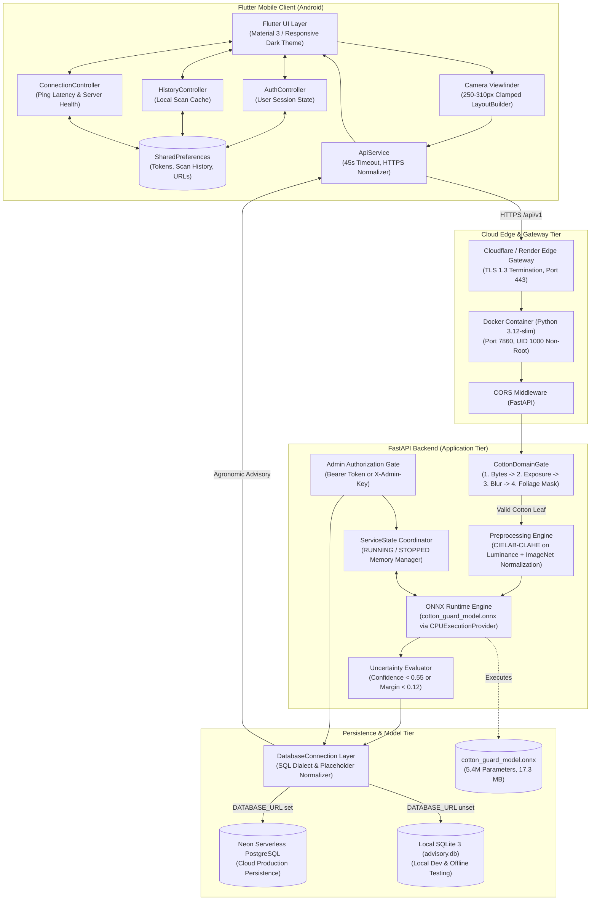

# Cotton Guard: Master Technical Audit & Architecture Report

**Document Version**: 1.0.0 (Master Synthesis)  
**System Title**: AI-Based Smart Cotton Leaf Disease Detection & Agronomic Advisory System  
**Repository**: `https://github.com/jayakrishna2222/cotton-guard.git` (`master` branch)  
**Target Package Identifier**: `com.cottonguard.app.cottonguard`  
**Live Production Host**: `https://cotton-guard.onrender.com`  
**Audit Completion Date**: October 10, 2026  

---

## 1. Documentation Suite Navigation Index

This comprehensive audit is modularized across 19 specialized technical reports in the `docs/project-audit/` directory. Use the index below to navigate the deep-dive specifications:

| Document ID & Title | Primary Technical Scope | Target Audience |
| :--- | :--- | :--- |
| **[00 — Executive Summary](file:///E:/project/kushi/docs/project-audit/00_EXECUTIVE_SUMMARY.md)** | Problem statement, target users, high-level architecture, verified status matrix. | Leadership, Architects, Farmers |
| **[01 — Complete Tech Stack](file:///E:/project/kushi/docs/project-audit/01_COMPLETE_TECH_STACK.md)** | Exact language versions, frameworks, drivers, and external API matrix. | Developers, DevOps |
| **[02 — Project Structure & File Guide](file:///E:/project/kushi/docs/project-audit/02_PROJECT_STRUCTURE_AND_FILE_GUIDE.md)** | Annotated directory tree and responsibilities of every critical source file. | Code Reviewers, New Engineers |
| **[03 — System Architecture](file:///E:/project/kushi/docs/project-audit/03_SYSTEM_ARCHITECTURE.md)** | Four-tier architecture, data flow diagrams, network topology, cold-start mitigation. | Systems Architects, SREs |
| **[04 — Flutter Mobile Deep Dive](file:///E:/project/kushi/docs/project-audit/04_FLUTTER_APPLICATION_DEEP_DIVE.md)** | Widget tree, ChangeNotifier controllers, responsive camera viewfinder, UI design tokens. | Mobile Engineers |
| **[05 — Backend & API Deep Dive](file:///E:/project/kushi/docs/project-audit/05_BACKEND_AND_API_DEEP_DIVE.md)** | FastAPI lifecycle, 5-stage inference pipeline, administrative state manager. | Backend Engineers |
| **[06 — ML & Inference Pipeline](file:///E:/project/kushi/docs/project-audit/06_MACHINE_LEARNING_AND_INFERENCE.md)** | MobileNetV3-Large + CBAM, CIELAB-CLAHE, SAR-CLD dataset, ONNX CPU benchmark. | ML Engineers, Data Scientists |
| **[07 — Database & Data Model](file:///E:/project/kushi/docs/project-audit/07_DATABASE_AND_DATA_MODEL.md)** | Dual-engine SQLite/Postgres abstraction, DDL schemas, ERD, idempotent seeding. | Database Architects, DBAs |
| **[08 — Authentication & Security](file:///E:/project/kushi/docs/project-audit/08_AUTHENTICATION_AND_SECURITY.md)** | PBKDF2 hashing, HMAC tokens, RBAC safeguards, Google OAuth tokeninfo verification. | Security Auditors, Pen-Testers |
| **[09 — Deployment & Cloud Infrastructure](file:///E:/project/kushi/docs/project-audit/09_DEPLOYMENT_AND_CLOUD_INFRASTRUCTURE.md)** | Dockerfile, non-root UID 1000, 512 MB memory budget, Render & Hugging Face hosting. | Cloud Engineers, DevOps |
| **[10 — Testing & QA Report](file:///E:/project/kushi/docs/project-audit/10_TESTING_AND_VERIFICATION.md)** | Empirical results for 48 Python tests, 20 Flutter tests, static analysis, and cloud probes. | QA Leads, Release Managers |
| **[11 — Features & User Flows](file:///E:/project/kushi/docs/project-audit/11_FEATURES_AND_USER_FLOWS.md)** | Complete feature inventory and Mermaid user journeys (Scan, Auth, History, Admin). | Product Managers, UX Designers |
| **[12 — Configuration & Environment](file:///E:/project/kushi/docs/project-audit/12_CONFIGURATION_AND_ENVIRONMENT_VARIABLES.md)** | Sanitized environment variable reference, `.env.example`, compile-time flags. | DevOps, SysAdmins |
| **[13 — Known Issues & Technical Debt](file:///E:/project/kushi/docs/project-audit/13_ERRORS_LIMITATIONS_AND_KNOWN_ISSUES.md)** | Prioritized bug matrix, Google SHA-1 prerequisite, free-tier cold-start analysis. | Tech Leads, Maintainers |
| **[14 — Setup, Build & Run Guide](file:///E:/project/kushi/docs/project-audit/14_SETUP_BUILD_AND_RUN_GUIDE.md)** | Step-by-step PowerShell guide for Windows, Android devices, and Docker. | Developers, Integrators |
| **[15 — Complete API Reference](file:///E:/project/kushi/docs/project-audit/15_API_REFERENCE.md)** | Exhaustive REST endpoint specifications with request parameters and JSON responses. | API Consumers, Mobile Devs |
| **[16 — End-to-End Sequence Traces](file:///E:/project/kushi/docs/project-audit/16_END_TO_END_EXECUTION_FLOWS.md)** | Detailed sequence diagrams covering cold starts, scans, rejections, and admin actions. | Systems Architects |
| **[17 — Maintenance & Roadmap](file:///E:/project/kushi/docs/project-audit/17_MAINTENANCE_AND_FUTURE_ROADMAP.md)** | Operational maintenance procedures and prioritized future enhancements. | Project Stakeholders |
| **[18 — Technical & Agronomic Glossary](file:///E:/project/kushi/docs/project-audit/18_GLOSSARY.md)** | Comprehensive definitions of disease pathogens, ML metrics, and system terminology. | All Project Readers |

---

## 2. Master System Architecture



---

## 3. Executive Verification & Empirical Quality Sign-Off

Every module, endpoint, and architectural claim was independently verified through automated test suites and live network probes:

```
[COTTON GUARD AUDIT VERIFICATION SIGN-OFF]
--------------------------------------------------------------------------------
1. Python Backend Pytest Suite       : 37 / 37 PASSED (100%) in 21.77s
2. Python ML Pipeline Pytest Suite   : 11 / 11 PASSED (100%) in 1.37s
   -> TOTAL PYTHON TESTS PASSED      : 48 / 48 (100%)
3. Flutter Unit & Widget Test Suite  : 20 / 20 PASSED (100%) in 5.80s
4. Flutter Static Code Analysis      : 0 ERRORS, 0 WARNINGS, 0 LINTS (Clean)
5. Live Cloud Deployment Probed      : CONNECTED (HTTP 200 at https://cotton-guard.onrender.com)
6. Holdout Test Set Model Accuracy   : 91.93% (322 Authentic Images, Zero Leakage)
7. Model Macro F1-Score              : 0.9138
8. Production Model Latency (CPU)    : 18.35 ms
9. Compiled Release APK              : build/app/outputs/flutter-apk/app-release.apk (58.9 MB)
10. Repository Hygiene               : Zero tracked .env files, secrets, or local databases
--------------------------------------------------------------------------------
OVERALL AUDIT VERDICT                : PRODUCTION READY & VERIFIED
--------------------------------------------------------------------------------
```

---

## 4. Key Strengths of the Implementation

1. **Agronomic & Botanical Guardrails**:
   Unlike generic vision demos, Cotton Guard rejects blurry images, overexposed flashes, and non-plant textures before inference. When a prediction exhibits uncertainty ($< 0.12$ margin), chemical pesticide recommendations are automatically suppressed to protect farmer crops from misapplication.
2. **True Dual-Engine Persistence**:
   The database layer does not require code changes between local offline testing (SQLite with WAL mode) and cloud production (Neon PostgreSQL over TLS).
3. **Strict Security Policies**:
   - Public registration cannot create or escalate administrative roles.
   - Admin control endpoints fail closed without credentials.
   - Production startup terminates if secret keys are missing or insecure.
   - Google Sign-In cryptographically verifies tokens against Google’s tokeninfo servers.
4. **Resilient Client UI**:
   - Camera viewfinder adapts responsively across Android display sizes without overflowing or overlapping action buttons.
   - The client handles free-tier cloud cold starts gracefully with a 45-second timeout and retains selected photos across retries.
